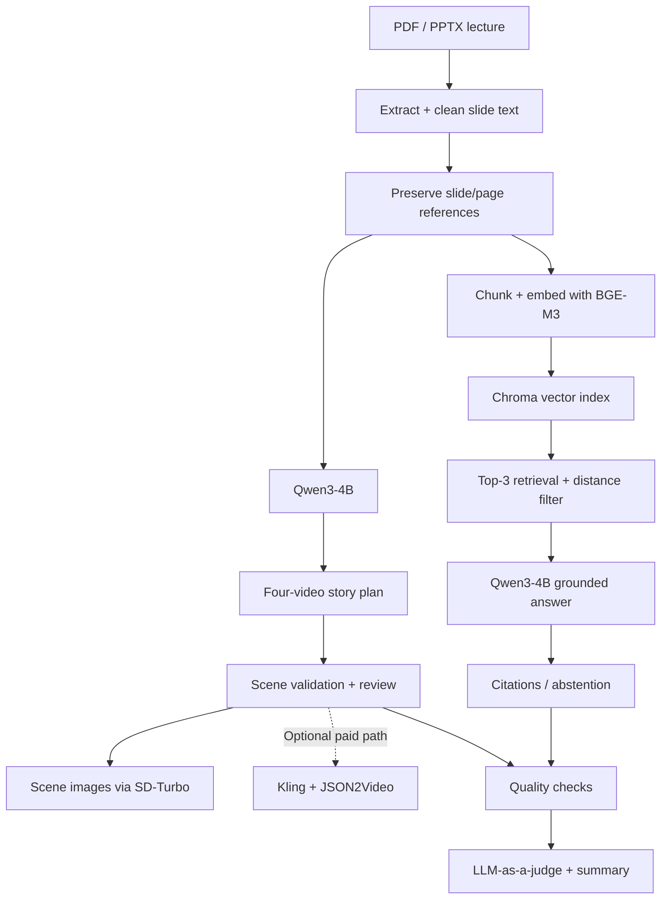

<div align="center">


# FAHEM | فاهم

### From Lectures to Understanding.

**Your lectures. Reimagined by AI.**

*An educational AI prototype that turns lecture slides into visual learning stories and supports questions grounded in the original material.*


**[Overview](#-the-idea) · [Architecture](#-architecture) · [Implementation](#-inside-the-system) · [Evaluation](#-evaluation--limitations) · [Run](#-getting-started) · [Team](#-meet-the-team)**

[](https://colab.research.google.com/github/Lamya-Al/FAHEM/blob/main/notebooks/FAHEM_Integrated_App.ipynb)

</div>

---

## 💡 The Idea

### The problem
Lecture slides are useful references, but they are not always easy to revisit or understand without an instructor. Reading through a slide deck can also make it difficult to see the relationships between concepts.

### Our approach
**FAHEM** explores a complementary learning experience with two connected workflows, both based on the uploaded lecture:

| **Learn visually** | **Ask with context** |
| :-- | :-- |
| Convert slide content into a structured story for **four connected short educational videos**. | Retrieve passages from the same lecture and generate responses with slide/page references. |
| Generate scene descriptions and narration; optionally create scene images and use paid video services. | Apply retrieval thresholds and an abstention response when evidence is insufficient. |

> **Prototype scope:** Generated story plans, scene images, and paid video rendering are different outputs. A complete rendered video is **not** produced by the default free configuration.

## ✨ What FAHEM Includes

- **Lecture ingestion:** PDF and PowerPoint (`.pptx`) text extraction.
- **Content preparation:** cleaning, structured idea labels, and slide/page-aware chunks.
- **Story generation:** Qwen3-4B plans four connected educational videos and their scenes.
- **Output checks:** validation and safety checks for generated scene content.
- **Free visual mode:** optional SD-Turbo image generation for individual scenes in the application.
- **Lecture-grounded chat:** BGE-M3 embeddings, Chroma retrieval, and Qwen3-4B responses with citations.
- **Evaluation notebook:** retrieval checks, abstention checks, citation checks, and a Qwen-based LLM-as-a-judge.
- **Interactive app:** a Colab-hosted FastAPI interface with a lecture upload flow, approval step, learning feed, and chat.
- **Optional paid integration:** Kling video generation and JSON2Video assembly, disabled by default and requiring API credentials.

## 🧩 Architecture



## 🛠 Inside the System

| Component | Actual implementation |
| :-- | :-- |
| Main language model | `Qwen/Qwen3-4B`, loaded once in 16-bit precision for generation, chat and judging |
| Embedding model | `BAAI/bge-m3` |
| Vector database | Chroma, in-memory cosine-distance collection |
| Retrieval | Top 3 (`TOP_K=3`), with a configured cosine-distance cutoff |
| Free scene imagery | `stabilityai/sd-turbo` (app mode, subject to runtime availability) |
| Application | FastAPI + notebook-hosted web UI |
| Optional paid video | Kling via `fal-client`, with JSON2Video for multi-shot assembly |
| Training | **No fine-tuning, alignment training or quantization** in this notebook |

### One notebook, connected workflows

All of the implementation is collected in **one notebook**—not separate artificial modules:

`notebooks/FAHEM_Integrated_App.ipynb`

The notebook covers **setup → lecture upload → preprocessing → scene planning → retrieval/chat → evaluation → optional video integration → web application**.

## 📊 Evaluation & Limitations

The notebook includes automated checks and a 20-question retrieval/QA test configuration. **The saved run is an engineering diagnostic, not evidence of production-level accuracy.**

In the uploaded notebook's saved execution:

| Diagnostic | Observed in saved run |
| :-- | --: |
| Retrieval Hit@3 | **0.20** |
| Correct abstention | **0.25** |
| LLM-judge PASS rate | **0.55** |
| Mean judge score | **4.05 / 5** |

**How to interpret this:** the saved notebook run used a **Stacks and Queues lecture**, while its 20 configured evaluation questions were written for a **Water Cycle lecture**. These are mismatched inputs, so the metrics **must not be presented as a valid assessment of FAHEM's performance**. Several questions were abstained on; grounded-answer and citation metrics were unavailable in that run. The scene-generation output also reported that not all coverage checks passed.

**Before publishing performance claims:** prepare a lecture-matched question set, rerun the evaluation, review missing scene coverage, and report the actual outcomes and sample sizes. The LLM judge uses the *same base model* as the answer generator; its scores are screening signals rather than independent validation.

## 🚀 Getting Started

1. Open **[the notebook in Colab](https://colab.research.google.com/github/Lamya-Al/FAHEM/blob/main/notebooks/FAHEM_Integrated_App.ipynb)** after it has been uploaded to the referenced repository path.
2. In Colab, choose **Runtime → Change runtime type → T4 GPU** (subject to Colab availability).
3. Run the setup cell to install packages, then load Qwen3-4B.
4. Upload a **text-based PDF or `.pptx`** lecture; scanned PDFs require OCR not provided in this notebook.
5. Run the preprocessing and story generation cells, then the BGE-M3 / Chroma / grounded-chat cells in order.
6. Optionally run evaluation **with questions that match the lecture you uploaded**.
7. Run the application cell to open its Colab-hosted interface. In the app, scene pictures depend on the SD-Turbo model and available GPU resources.

**Paid services are disabled by default.** Leave `ENABLE_PAID_VIDEO = False` to avoid the optional paid path. If you deliberately enable it, read the billing steps first and configure credentials through **Colab Secrets**, not by pasting them into code. The app also has a separate `KLING_ON = False` setting.

**Runtime notes:** Models download during first use, the notebook requires a GPU, and application state is temporary within the Colab runtime. Avoid uploading confidential or copyrighted lectures without permission.

## 🗂 Repository Layout

```text
FAHEM/
├── README.md
├── assets/
│   └── fahem-logo.png
└── notebooks/
    └── FAHEM_Integrated_App.ipynb
```

## 🧭 Next Improvements

- Align each benchmark set with the lecture being tested and report validated results.
- Improve scene coverage and ensure every generated story passes defined checks.
- Compare retrieval thresholds on in-scope versus out-of-scope questions.
- Add verified demo screenshots/videos and a reproducible sample lecture where redistribution is permitted.
- Extract reusable modules from the notebook if the prototype becomes a maintained application.

## 👥 Meet the Team

FAHEM was developed collaboratively as a capstone project in the **Generative AI Applications Engineering bootcamp**. Each teammate can document their own contributions below before the final team review.

| Team member | Contribution focus |
| :-- | :-- |
| **Leen Khaled** | *To be added by Leen* |
| **Lamya Alkathery** | *To be added by Lamya* |
| **Sadeem Alshamrani** | **LLM Prompt Engineering · Output Testing · Human Evaluation** |

### Leen Khaled — Contributions

> **To be completed by Leen.** Replace this note with a short description of your role, followed by 2–4 concrete contributions.

- **Primary focus:** *[Add your area of responsibility]*
- **What I implemented:** *[Add verified features, code, or workflows]*
- **Testing or results:** *[Add relevant work or evidence]*
- **Collaboration:** *[Add cross-team contributions, if applicable]*

### Lamya Alkathery — Contributions

> **To be completed by Lamya.** Replace this note with a short description of your role, followed by 2–4 concrete contributions.

- **Primary focus:** *[Add your area of responsibility]*
- **What I implemented:** *[Add verified features, code, or workflows]*
- **Testing or results:** *[Add relevant work or evidence]*
- **Collaboration:** *[Add cross-team contributions, if applicable]*

### Sadeem Alshamrani — Contributions

**Focus: LLM Prompt Engineering, Output Testing & Human Evaluation**

- **Prompt engineering:** Worked on refining and organizing prompts for the lecture-to-scene generation workflow, with attention to structure, educational clarity, and faithfulness to lecture content.
- **Output testing:** Reviewed generated educational scenes using sample lecture topics, documented observations, and identified recurring issues or opportunities to improve the generated narratives.
- **Human evaluation:** Used a rubric-based assessment to review aspects of generated outputs such as factual accuracy, clarity, coherence, and suitability for learning.
- **Iteration and reporting:** Organized evaluation notes and contributed recommendations for future prompt and generation improvements.

> **Contribution scope:** Individual sections describe work performed by each teammate, not exclusive ownership of shared components. Human evaluation is separate from the notebook's automated checks and LLM-as-a-Judge.

---

<div align="center">

**FAHEM | فاهم**  
*From Lectures to Understanding.*

</div>
