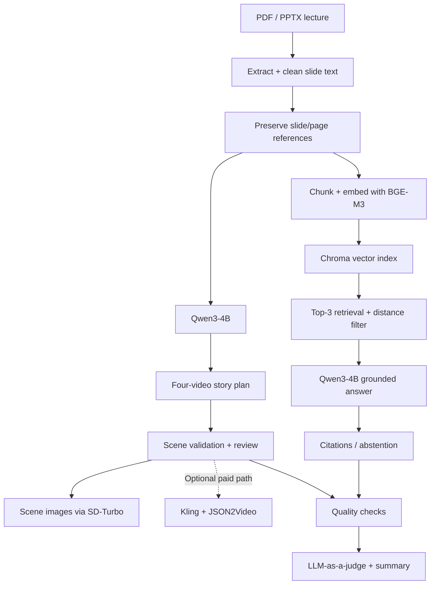

# FAHEM | فاهم

### From Lectures to Understanding.

**Your lectures. Reimagined by AI.**

*An educational AI prototype that turns lecture slides into visual learning stories and supports questions grounded in the original material.*

**[Overview](#-the-idea) · [Architecture](#-architecture) · [Implementation](#-inside-the-system) · [Evaluation](#-evaluation--limitations) · [Run](#-getting-started) · [Team](#-meet-the-team)**

---

## 💡 The Idea

### The problem
Lecture slides are useful references, but they are not always easy to revisit or understand without an instructor. Reading through a slide deck can also make it difficult to see the relationships between concepts.

### Our approach
**FAHEM** explores a complementary learning experience with two connected workflows, both based on the uploaded lecture:

| **Learn visually** | **Ask with context** |
| :-- | :-- |
| Convert slide content into a structured story for **four connected short educational videos**. | Retrieve passages from the same lecture and generate responses with slide/page references. |
| Generate scene descriptions and narration; optionally create scene images and use paid video services. | Apply retrieval thresholds and an abstention response when evidence is insufficient. |

> **Prototype scope:** Generated story plans, scene images, and paid video rendering are different outputs. A complete rendered video is **not** produced by the default free configuration.

##  Installation and running (step by step)

The project is one notebook, `Fahem_Integrated_App_fixed__1_.ipynb`, built for **Google Colab with a T4 GPU**. No local installation is needed.

1. Open the notebook in Google Colab.
2. Select a GPU: Runtime → Change runtime type → **T4 GPU**.
3. Run **cell 1 (Setup)**. It installs the libraries and keeps paid video off (`ENABLE_PAID_VIDEO = False`).
4. Run **cell 2 (Upload)** and choose your lecture as a `.pdf` or `.pptx` file.
5. Run **cell 3** to download and load Qwen3-4B (about 8 GB on the first run).
6. Run **cell 4 (Preprocessing)** to clean the text and tag every idea line `[S1]`, `[S2]`, ...
7. Run **cell 5 (Story generator)** to write the 4 connected videos.
8. Run the **chatbot cells** in order: settings and chunking, R2 index, grounded answers.
9. Run the **last cell (Fahem app)** and click **🔗 Open Fahem**.
10. In the app: upload a lecture, review the plan, press **Approve**, swipe through the videos, and ask questions.

---

## 🧩 Architecture

## 🛠 Inside the System

| Component | Actual implementation |
| :-- | :-- |
| Main language model | `Qwen/Qwen3-4B`, loaded once in 16-bit precision for generation, chat and judging |
| Embedding model | `BAAI/bge-m3` |
| Vector database | Chroma, in-memory cosine-distance collection |
| Retrieval | Top 3 (`TOP_K=3`), with a configured cosine-distance cutoff |
| Free scene imagery | `stabilityai/sd-turbo` (app mode, subject to runtime availability) |
| Application | FastAPI + notebook-hosted web UI |
| Optional paid video | Kling via `fal-client`, with JSON2Video for multi-shot assembly |
| Training | **No fine-tuning, alignment training or quantization** in this notebook |

### One notebook, connected workflows

All of the implementation is collected in **one notebook**—not separate artificial modules:

`notebooks/FAHEM_Integrated_App.ipynb`

The notebook covers **setup → lecture upload → preprocessing → scene planning → retrieval/chat → evaluation → optional video integration → web application**.

### Model

| Component | Choice | Notes |
|---|---|---|
| Language model | `Qwen/Qwen3-4B`, 16-bit | 4 billion parameters. No fine-tuning, alignment or quantization. |
| Adaptation | Prompt engineering + RAG | |
| Retriever | `BAAI/bge-m3` | Embeds slides and questions. |
| Vector store | Chroma (cosine) | Top 3 slides. |
| Video (paid mode, off by default) | Kling V3 via fal.ai + JSON2Video | |

### Data

- **Input:** slides (PDF or PPTX) uploaded by the user. No training data is used, since the model is not fine-tuned.
- **Testing:** 20 new lectures the model had not seen. The chatbot test set is 20 questions (15 in-scope, 5 out-of-scope) 
- **Preprocessing:** removes page numbers, repeated headers and footers, links, duplicates and noise.

---

##  Results

Measured on 20 new test lectures the model had not seen.

| Metric | Result | 
|---|---|---|
| Accuracy (human rating, divided by 5) | 0.76 |
| Clarity (human rating) | 0.73 | 
| Safety (human rating) | 1.00 | 
| RAG hit rate @3 (correct slide in top 3, 20 questions) | 1.00 |
| Average time to create the 4 clips | 4.5 min | 

---

##  Data sources and licenses

| Resource | Source | License |
|---|---|---|
| Qwen3-4B | Alibaba Qwen team, Hugging Face | Apache 2.0 |
| BGE-M3 | BAAI, Hugging Face | MIT |
| SD-Turbo | Stability AI, Hugging Face | Stability AI license (check current terms) |
| ChromaDB, Transformers, Gradio | Open-source libraries | Apache 2.0 |
| Kling V3 (fal.ai), JSON2Video | Paid third-party services | Provider terms of service |
| Lecture slides | Uploaded by the user / the 20 test lectures |

---

##  Team members and roles

| Member | Role |
|---|---|
| Leen Khaled (لين خالد) | Prompt engineering, evaluation, interface  |
| Lamia Alkathiri (لمياء الكثيري) | Prompt engineering, evaluation, RAG |
| Sadeem Alshamrani (سديم الشمراني) | Prompt engineering, evaluation, RAG |

