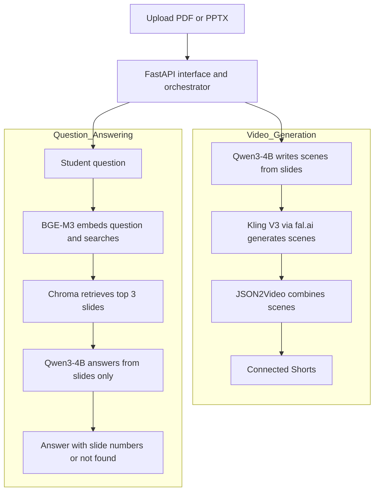

# FAHEM
## 1. What the project does, and for whom

Fahem turns lecture slides (PDF or PPTX) into a series of **4 short, connected, story-style videos**, and includes an assistant that answers questions **only from the uploaded slides**, with slide numbers. If the answer is not in the slides, it says so.

**Who it is for:** university students who find long slide decks hard to read and tend to forget them, and instructors who want an engaging companion to their lecture material.

---

## 2. Installation and running (step by step)

The project is one notebook, `Fahem_Integrated_App_fixed__1_.ipynb`, built for **Google Colab with a T4 GPU**. No local installation is needed.

1. Open the notebook in Google Colab.
2. Select a GPU: Runtime → Change runtime type → **T4 GPU**.
3. Run **cell 1 (Setup)**. It installs the libraries and keeps paid video off (`ENABLE_PAID_VIDEO = False`).
4. Run **cell 2 (Upload)** and choose your lecture as a `.pdf` or `.pptx` file.
5. Run **cell 3** to download and load Qwen3-4B (about 8 GB on the first run).
6. Run **cell 4 (Preprocessing)** to clean the text and tag every idea line `[S1]`, `[S2]`, ...
7. Run **cell 5 (Story generator)** to write the 4 connected videos.
8. Run the **chatbot cells** in order: settings and chunking, R2 index, grounded answers.
9. Run the **last cell (Fahem app)** and click **🔗 Open Fahem**.
10. In the app: upload a lecture, review the plan, press **Approve**, swipe through the videos, and ask questions.

---

## 3. Architecture, model and data

### Architecture

The orchestrator accept a PDF or PPTX lecture and support two paths: video generation and questions about the uploaded lecture.



    ### Model

| Component | Choice | Notes |
|---|---|---|
| Language model | `Qwen/Qwen3-4B`, 16-bit | 4 billion parameters. No fine-tuning, alignment or quantization. |
| Adaptation | Prompt engineering + RAG | |
| Retriever | `BAAI/bge-m3` | Embeds slides and questions. |
| Vector store | Chroma (cosine) | Top 3 slides. |
| Pictures (free mode) | `stabilityai/sd-turbo` | One picture per scene. |
| Video (paid mode, off by default) | Kling V3 via fal.ai + JSON2Video | |

### Data

- **Input:** slides (PDF or PPTX) uploaded by the user. No training data is used, since the model is not fine-tuned.
- **Testing:** 20 new lectures the model had not seen. The chatbot test set is 20 questions (15 in-scope, 5 out-of-scope) on a 10-slide water-cycle lecture.
- **Preprocessing:** removes page numbers, repeated headers and footers, links, duplicates and noise.

---

## 4. Results

Measured on 20 new test lectures the model had not seen.

| Metric | Result | Target |
|---|---|---|
| Accuracy (human rating, divided by 5) | 0.76 | 0.90 |
| Clarity (human rating) | 0.73 | 0.90 |
| Safety (human rating) | 1.00 | 0.90 |
| RAG hit rate @3 (correct slide in top 3, 20 questions) | 1.00 | 0.90 |
| Average time to create the 4 clips | 4.5 min | not set |

---

## 5. Data sources and licenses

| Resource | Source | License |
|---|---|---|
| Qwen3-4B | Alibaba Qwen team, Hugging Face | Apache 2.0 |
| BGE-M3 | BAAI, Hugging Face | MIT |
| ChromaDB, Transformers, Gradio | Open-source libraries | Apache 2.0 |
| pypdf | Open-source library | BSD |
| Kling V3 (fal.ai), JSON2Video | Paid third-party services | Provider terms of service |
| Lecture slides | Uploaded by the user / the 20 test lectures | 
---

## 6. Team members and roles

| Member | Role |
|---|---|
| Leen Khaled | TODO |
| Lamya Alkathery | TODO |
| Sadeem Alshamrani | TODO |

    U --> Q
```

- **Video generation:** Qwen3-4B writes scenes from the slide text. Kling V3 generates approximately 10-second scenes through fal.ai. JSON2Video combines these scenes into connected Shorts lasting approximately 30 seconds to 1 minute each.
- **Question answering:** BGE-M3 embeds the student's question and searches slide embeddings in Chroma. Each chunk represents one slide. The top 3 slides provide context for Qwen3-4B, which answers with slide numbers or states that the answer is not found in the slides.
